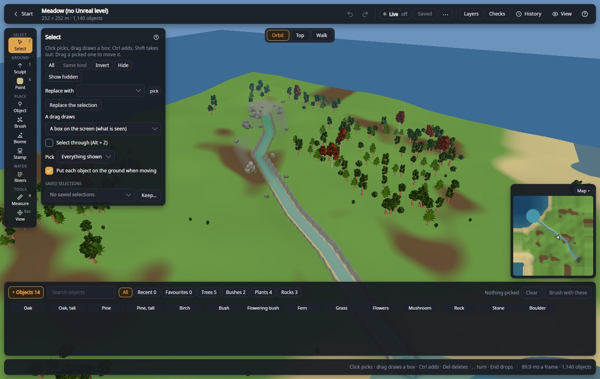

# Groundwork

A world editor for Unreal Engine: shape a map's ground, paint its layers, place and move objects, draw rivers and
lakes, and see every change in the Unreal editor as you make it.

Groundwork comes from [Valheim World Editor](https://github.com/Shuiei/valheim-world-editor) by Thibault Bene: its 3D
view, brushes, selection, history, help and Claude connection are his work, turned into an editor for any map.

*The sample map (`samples/Meadow`): the tool rail on the left, the tool's card beside it, the objects drawer along the
bottom.*

## Start here

- [Install the editor](start/install.md)
- [Map projects](map.md)
- [The window](editor-basics.md)

## Tools

- [Sculpt and paint](terrain.md)
- [Select](select.md)
- [Objects](objects.md)
- [Rivers and lakes](water.md)
- [Measure](measure.md)
- [The Mask](masks.md)

## Beyond the editor

- [Unreal](unreal.md)
- [Plugins](plugins.md)
- [Claude](claude.md)
- [Keys and mouse](help/shortcuts.md)
- [Translating](translating.md)
