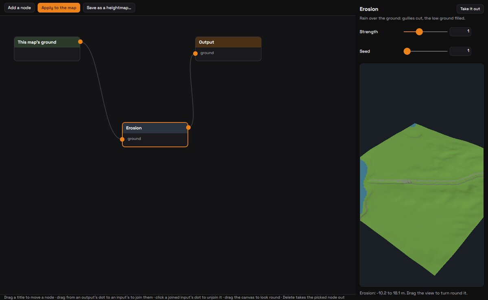

# Ground graph

**⋯ → Ground graph…** builds ground from nodes joined by wires, as terrain tools do: make some ground, wear it, mix
it with other ground through a mask, and apply what comes out to the map. Change any node and everything after it is
made again; what comes before it is kept, so trying a number takes a moment, not a whole remake.

## Use it

1. **Add a node** puts one on the canvas; its menu groups them as below.
2. Drag from a node's output (the dot on its title's right) to another's input (a dot on its left) to join them. A
   wire into an input that has one replaces it. Click a joined input's dot to unjoin it.
3. Click a node to see its numbers on the right, and below them its ground in 3D (drag it to turn round it).
4. **Apply to the map** makes the **Output** node's ground the map's: one step in History, so `Ctrl+Z` takes it back.
   **Save as a heightmap…** writes it as a 16-bit PNG or `.r16` instead.

Drag a node's title to move it, the empty canvas to look round; `Delete` takes the picked node out. The graph is kept
in the map's folder (`ground-graph.json`) as you change it, and opens as you left it. A map's first graph starts from
its own ground, worn by erosion.

## Nodes

| Group | Nodes |
|---|---|
| Make | **Hills** (rolling ground between two heights; its ridges), **Flat**, **This map's ground** (as it was when the graph opened), **Heightmap** (a file stretched over the map; a GeoTIFF brings its own heights), **Mountain** (a peak, ridge, range, mesa, volcano or hills on flat ground at 0, placed east and north of the middle: **Add** it to other ground), **Formula** (heights from `x`, `z`, `w`, `l`, `h` and `n(x, z)`, as the [Shape tool's](shapes.md#shape)). |
| Shape | Each of New map's shaping steps with its own numbers (**Expand**, **Valleys**, **Glaciers**, **Strata**, **Erosion**, **Scree**, **Sea cut back**, **Dunes**, **Crags**), and **Smooth**, **Terraces** (flat treads and steep risers so many metres apart) and **Height range** (stretched between two heights). |
| Combine | **Blend** (B's share of B over A, or where a mask joined to its third input says), **Add** (B times a number on A), **Highest of**, **Lowest of**. |
| Mask | **Terrain mask** (1 where a [terrain map](map.md#exporting-the-terrain-maps) or the slope is in a range, softly at its edges) and **Height mask** (the same by height), for Blend's mask. |
| Output | The ground the graph makes. |

A graph to start from: **This map's ground** into **Terrain mask** (Wetness from 0.6) and, separately, into **Smooth**
(radius 20); **Blend** with the map's ground as A, the smoothed as B and the mask as its mask, into the **Output**: the
wet valley floors eased flat, the rest as it was.
