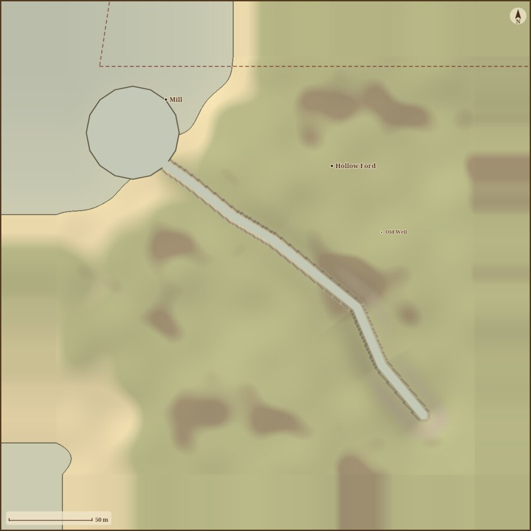

# Map projects

A map is a folder: a `map.json` and the files it names beside it. The start page shows the maps you opened as cards
(a picture of the ground, the size, how many objects, when it was last saved, whether it has an Unreal project), grouped
by the folder they are in, the last opened first; with more than a few, a search box narrows them by name. **Open map
folder…** adds one, **New map…** makes one; a map folder or a heightmap dropped on the page opens it or starts New map
over it, and Enter opens the first card, Ctrl+N and Ctrl+O the two buttons. A card's right-click menu opens the map,
shows its folder in the file manager, duplicates it beside itself ("Name copy") or takes it off the list (the folder
stays). A map whose folder is gone stays on the list, greyed, until taken off.

## A new map

**New map…** opens the generator: a name, a size in 63 m squares (the size of an Unreal landscape component, plus one
metre), a style, and the style's numbers as sliders, with the ground they make in 3D beside them. The preview is made
again a moment after a slider stops; drag it to turn round it, the wheel to come nearer. It shows the ground, its paint,
woods and water; trees, rocks, camps and floating islands come only with **Make the map**. The map goes in the maps
folder (**Settings**; `Documents/Groundwork` unless you choose another), centred on the origin. It shares the open map's
model folder and starts with a copy of its catalog.

The styles: rolling woods, grassland with plateaus, sky islands, broken badland at the world's edge, mesas and canyons,
savanna, tundra coast, marsh coast, highlands, fjords; each fills in every slider and brings its own shapes. **Flat
ground** and **Gently rolling ground** at the end of the list make a map with nothing on it. Every slider's number can
be typed too (past the slider's ends as well), and **Another** seed makes other ground from the same numbers. The
sliders, by group:

| Group | Sliders |
|---|---|
| Ground | The lowest and highest ground; how far apart the hills are; roughness (small bumps so no ground is quite flat); terrace steps and how much of the ground is terraced; canyons' depth, width and spacing; fjords' depth (under the sea at their mouths), width and spacing; cliffs from (ground steeper than this faced with walls of rock: the map's own cliff pieces, overlapping along it, the ground stepped behind them so the grass runs to the edge; 0: none); crags (the rock faces' grain, so deep: crags, buttresses and gullies, ribs and chutes running down them, on the faces that break from the slope round them and on cliffs, not on every steep hillside; 0: smooth); strata (bands of rock so thick cut back into the steep faces, ledges and risers on a gentle tilt; 0: none); erosion (rain over the whole map cutting valleys and gullies and filling the low ground; 1 is as much as the brush's fill; 0: none); scree angle (ground steeper than this slides down and rests at it, piling at the foot of every face; 0: none); ridges (the share of the hills that are sharp-crested ridges rather than rounded); expand (the high ground broadened so many metres into plateaus, or with a negative number the valleys widened to flat floors; 0: none); valleys (streams gathering off the high ground cut valleys down it, branching up into the hills, and lay what they cut lower down: fans at the feet of slopes, flat valley floors; 0: none); glaciers (the valleys fed from the high ground, above the snow line or else the land's highest quarter, carved by ice into troughs about so many metres across: flat floors, steep walls, spurs cut off, down to where the ice melts a couple of hundred metres under the line; 0: none); dunes (sand dunes on flat open land, so many metres high, lying across the wind: a long gentle slope up on the windward side, a short steep one down the lee, broken into separate crests and painted with the sand layer; 0: none) and the wind's direction (0 east, 90 south). With erosion or scree on, what they laid down is painted earth and the channels they cut rock. |
| Mountain rim | A rim of ridged mountains round the edge, high in places and lower in others (0: none), and its width. |
| Coast | How far in from one side the ground goes under the sea (0: none), how deep (up to 800 m), which side, or a drop into nothing instead; and how far the sea has cut the land back (**Sea cut back**: a bench rising gently from the water, more at the bays and less at the headlands, so low shores become beaches and higher ground behind is left as a sea cliff; 0: none). |
| Water | How many lakes and the biggest one's size (each next about half the last), set in the low ground with banks sloping to the water; rivers, their width and how much they wind from side to side (**Meanders**); the sand along shores; marsh flats under a height, and the share of them that pools. |
| Woods & plants | The share of the ground under woods, trees per hectare in the woods and in the open, the trees' size (a game's trees are often several times a real tree's), giant trees and their size, bushes and plants per hectare. |

**Shaping steps**, under the sliders, are the order the ground is shaped in once its hills, rim and coast are laid
and before the lakes, rivers, paint and planting: Expand, Valleys, Glaciers, Strata, Erosion, Scree, Sea cut back,
Dunes and Crags. Each follows its slider; a step can be switched off, moved earlier (↑) or later (↓), run again just
after (+) or taken out (✕), and its **×** box runs it stronger or weaker than its slider (×0.5: half). **Add a step…**
puts one at the end, **Usual order** puts them all back. Erosion before Strata wears the bands smooth; after, the
bands stay crisp. Erosion twice, the second at ×0.3, cuts deep valleys and then softens them. The steps are kept with
the map's numbers (`generator.spec.steps`), so **Make it again** starts from them.
| Paint | The slope rock is painted from, rock on crests (ridges, knolls and the lips of faces rocked, so strongly; 0: none), streams (earth painted where the water gathers, down every valley, so strongly; 0: none), snow slides off (snow gone from ground steeper than this, settled in the hollows below the snow line; 0: none), the share of open ground patched with dirt, the height snow lies from. |
| Camps & roads | How many camps, buildings each, roads between them. |
| Extras | Floating islands. |

### Over a heightmap from another tool

**Ground → From a heightmap…** makes the map over ground you made elsewhere: export a heightmap from your terrain
tool as a 16-bit PNG, a raw `.r16` / `.raw` (16-bit, little-endian) or a raw `.r32` (32-bit float), of any width and
height. Real ground comes as a GeoTIFF elevation model (`.tif`: survey and satellite DEMs, such as a national
survey's or Copernicus's): its heights in metres and its pixel size are read from the file and fill **Black is**,
**White is** and **Across** for you (a DEM in degrees is measured in metres at its latitude, and its pixels made square),
and its holes (no-data points) are filled from the ground round them. A DEM tile is often larger than a map holds:
cut the part you want out of it first (any GIS tool does), or give a smaller **Across** to shrink it. The file holds no metres, so give them: **Across** (the world's size west to east in your tool; a metre a
sample to start with), and the heights its black and its white stand for (**Black is**, **White is**: your tool's
height range; under 0 is under the sea: to put your tool's water level at the sea, take it off both). A raw file holds
no width either: when it is not square, give its **Samples across**. Pictures start at their north edge; for a raw
file written from the south, tick **Its first row is the south edge**.

The map keeps the heightmap's own scale: north to south follows from **Across**, and each side is rounded up to
Unreal's 63 m squares (the last strip carries on the heightmap's edge). It holds up to 128 squares a side (about 8 km,
Unreal's biggest landscape) and 6400 squares in all (a 5 km square's worth), so a long, narrow world fits as well as a
square one.

The generator then measures the ground (its lowest and highest ground, how far apart its hills are) and lays the zone
over it like a sheet: paint by height and slope, woods, plants and trees, snow, follow your shape, and nothing changes
the ground itself. The sliders that would (the rim, the coast, terraces, canyons, fjords, crags, strata, erosion, scree, expand, valleys, roughness, marsh, cliffs,
lakes, rivers and camps) start at none; turn any of them up to have it worked into your ground. **Lowest ground** and
**Highest ground** stretch it between new heights; **Hills apart** is your ground's own and does not change. The
heightmap is kept beside the map as `base.npy` (`generator.base` in map.json), so **Make it again** lays the new numbers
over the same ground.

A generated map keeps its numbers (`generator` in map.json). Until it is worked on by hand and saved, **⋯ → Make it
again with other numbers…** opens the generator on them and makes the whole map again; **Undo make it again** goes back
to the numbers before. Once you change the map yourself it is yours, and the generator no longer offers to remake it.

The ground is painted by rule: rock on steep ground (less under trees), dirt under the woods and in patches, grass
elsewhere. The zone is planted with the open map's Trees, Bushes, Rocks and Plants.

The styles' shapes, beyond rolling hills: flat shelves with steep risers (plateaus, mesas), canyons cut down into the
ground, fjords (winding, branching inlets of the sea cut from the coast into high ground, or from every edge without a
coast: broken walls of rock, ribs and chutes running down the faces, buttresses and gullies, down to a flat floor,
deepest at the mouth, rising and narrowing inland until each ends; the walls are the ground itself, painted rock), a
coast on one side going under the sea or a cliff dropping into nothing, rivers running downhill into a lake or the sea
the way water would, round the hills on the ground's surface (a shallow bed, a pond where a hollow would hold the
water), floating islands (lumps of the map's own ground hanging in the air, rounded earth below, trees and rocks on top;
models written into its models folder as Islands kinds, so Unreal gets them like any other), snow above a height, marsh
flats with pools along the sea, small bumps over everything so no ground is quite flat, and camps: buildings (the
catalog's Buildings) in a ring round levelled ground with props (its Props) among them, joined one to the next by
levelled roads painted with the second layer, and giant trees: a share of the trees, here and there rather than in whole
groves, several times their kind's size (a game's few great trees make much of its canopy). The first layer is painted
on shores and snow (or the second, for a coast with beaches and snow), the second in patches over the open ground, the
third on steep ground.

## map.json

```json
{
  "name": "Coast",
  "origin": [-252, -252],
  "seaLevel": 0,
  "files": { "heights": "height.npy", "layers": "layers.png", "objects": "objects.json", "water": "water.json", "areas": "areas.json", "holes": "holes.png", "beds": "beds.bin" },
  "layers": [
    { "name": "Grass", "colour": "#6b9945" },
    { "name": "Sand", "colour": "#ccbd85", "channel": "r", "texture": "textures/sand.png", "size": 4 }
  ],
  "catalog": "catalog.json",
  "models": "/path/to/models",
  "stamps": "stamps",
  "unreal": { "project": "/path/to/Project", "apply": "/path/to/apply.sh", "waterPrefix": "GW_Water_" }
}
```

| Key | What it is |
|---|---|
| `origin` | Where the heightmap's first pixel is, in the engine's metres (x, y). One pixel is one metre. |
| `seaLevel` | The water's height, metres. The editor shows heights as the file has them. |
| `files.heights` | The ground: a float32 `.npy`, rows by columns, metres. |
| `files.layers` | The paint: a `.png` the size of the heightmap, one layer in each of its `r`, `g` and `b`. A map of more than four layers has a list of them, three more layers a file; files the list leaves out are named after the first (`layers2.png`, `layers3.png`), and one not made yet is unpainted. |
| `files.objects` | The objects: a JSON list of `[asset, x, y, z, turn x, y, z, scale]`, and an object of [plugin data](plugins.md) when there is any. |
| `files.water` | The rivers and lakes ([Rivers and lakes](water.md)). |
| `files.areas` | The areas ([Areas](areas.md)). |
| `files.names` | The names on places and the regions ([Names and regions](names.md)); written once the map has one. |
| `files.holes` | The holes: a grey `.png` the size of the heightmap, white where the ground is taken away; written once there is a hole. |
| `files.beds` | The ground kept under the beds of bedded objects (the catalog's `bed` kinds, [Objects](objects.md#the-catalog)): a count, then grid index and height pairs (int32, float32, little-endian); written once there is a bed. |
| `files.worn` | What **New map**'s rain, streams and scree moved, metres a point (float32 `.npy`, the heightmap's size; below 0 cut, above 0 laid down); written when the map is made with them, read by [Export the terrain maps](#exporting-the-terrain-maps). |
| `layers` | Up to eight: the first is the ground everywhere, the others are painted over it from a channel: `r`, `g`, `b` of the first layers file, `r2`, `g2`, `b2` of the second, `r3` of the third (in that order when not given). A layer's `texture` (a picture in the map's folder) is drawn instead of its colour, repeated every `size` metres (4 by default). |
| `catalog` | The kinds the object tools offer and the categories the View panel sorts by. |
| `models` | The model folder the 3D view draws objects with (it may be anywhere; see [Objects](objects.md#models)). |
| `unreal` | The Unreal project [Live](unreal.md) talks to, the script **Send to Unreal** runs, the texture the layers go into (else paint layers by name), the water bodies' label prefix. |

Every file the editor writes must be inside the map's folder and must not be a link: a map from someone else cannot
write anywhere else. The old files are kept as `.bak` on each save.

## Growing a map

**Grow map** on the rail adds 63 m squares all round or on one side, flat or carrying on the edge's relief. It saves
first, then opens the bigger map.

## Shortcuts

| Key | Action |
|---|---|
| `Ctrl+S` | Save the map. |
| `Ctrl+Space` | Show or hide the objects drawer. |
| `F1` | This help, at the page of what you are using. |

## Sharing a map

**⋯ → Pack the map to share** writes the map as one `.zip` to give to someone else. It holds the map's folder as last
saved (the editor offers to save first) and, if you choose **With the models**, the models its objects use, each with
the files it reads (a `.gltf`'s `.bin` and pictures), in a `models` folder beside the map. Models the map does not place
stay out. The package names nothing on your computer: `map.json` loses its models path and its Unreal project.

They unzip it and open the folder; the map finds its models in its own `models` folder. Models that could not go in
(not found, or a file outside the models folder) are listed in the message bar.

Pack with the models only for someone allowed to have them: bought packs usually may not be passed on. **Without
them** packs the map and its catalog, and the objects show as boxes until the models are put in `models`.

## Sharing with the team

A team can keep its maps on a team server of its own, reached over Tailscale. The server knows each person by their
Tailscale account, so there is no password. With no team server set, Groundwork works offline as always.

- **The address:** started from the Jatify Launcher, Groundwork uses the team server the Launcher gives. **Settings →
  Team** shows it; turn off *Use the Launcher's team server* to type another (a host or `host:port`) or to leave it
  empty and stay offline. **Check** asks the server who you are.
- **⋯ → Publish to the team** packs the open map with the models it uses (as **Pack the map to share** does) and
  sends it. Publishing it again sends a new version. If a teammate published a newer one since your copy, the server
  refuses, and you open the team's version first.
- **From the team**, on the start page, lists the maps the team keeps. Choose one and a folder; the map goes in a
  folder of its own there and opens.

When the server cannot be reached, Groundwork says so and offers to retry or to carry on offline.

**Crash reports:** when Groundwork closed unexpectedly (it crashed, was killed, or had an error it could not handle),
the next start asks whether to send a report to the team, showing exactly what goes: a short note of the run
(version, system, memory) and that run's log. Nothing is sent without **Send**, and nothing is asked with no team server
set. The log of that run is kept as `Groundwork.previous.log` in the data folder.

## Exporting the heightmap

**⋯ → Export the heightmap** writes the map's heights as they are now to a 16-bit grey PNG or a raw `.r16` file
(Unreal's landscape import formats, and most terrain tools'): 32768 is 0 m, 128 steps a metre, as an Unreal landscape
at Z scale 100 reads them. The first row is the map's first (its origin's) row.

## A picture of the map

**⋯ → Save a picture of the map** writes the whole map seen from straight above, north up, as a PNG 2048 pixels on its
longer side: the ground's colours shaded by its hills (lit from the north-west), the sea, lakes and rivers, the regions'
outlines and the [names](names.md), a scale bar and a north arrow. Pick **In colour** or **On parchment** (browns on old
paper). Use it as a game's own world map, a design page or a picture for the team.



## Exporting the terrain maps

**⋯ → Export the terrain maps and paint weights** writes grey 8-bit PNGs, the map's size, read off its ground as it is now, into a folder
you pick, each named after the map (`<map>_flow.png` and so on). Use them as an Unreal landscape's paint layers
(*Import from file* on a layer) or as masks in a material:

| Map | White where |
|---|---|
| `flow` | Water runs: the ground a point drains, from half a hectare (black) to 0.2 km² (white). Streams and gullies; black in hollows, where water would stand. |
| `wetness` | The ground stays wet: much water running in, little slope to run it off. Valley floors, the foot of slopes, and white in hollows (a lake's bed). |
| `slope` | The ground is steep: 0° black to 90° white. |
| `convexity` | The ground stands over its surroundings (ridges, crests). Grey is even ground, black the hollows. |
| `facing_north` | The slope runs down towards the map's first row; black towards its last. Flat ground is grey. |
| `facing_east` | The slope runs down towards the map's last column; black towards its first. |
| `snow` | Snow lies (3 m and more white): from the snow line up, deepest 60 m over it, more on slopes facing north (away from the sun) and in hollows, blown off the ridges, none past 50°, slid down off steep ground into drifts at its foot. The snow line is New map's **Snow from** when the map was made with one, else the height of the land's highest quarter. |
| `wear` | The generator's rain, streams and scree cut the ground (24 m and more white): valleys, gullies, bare channels. |
| `deposits` | They laid it down (24 m and more white): fans, valley floors, screes at the foot of faces. |

`wear` and `deposits` come only from a map made by **New map** with Valleys, Erosion or Scree on; they are what the
generator moved when it made the map (kept in `worn.npy`), so ground reshaped by hand since is not in them, and a map
grown since has none. The others are read off the ground as it is when you export.

With them come the paint's weights, one PNG a layer (`<map>_paint_<layer>.png`): how much of each point is that layer,
every point's layers adding up to white, the first layer taking what the others leave. That is what an Unreal
landscape's weight-blended layers take on import (**Make the Unreal landscape** sends the same), and other engines' and
tools' splat maps alike.
