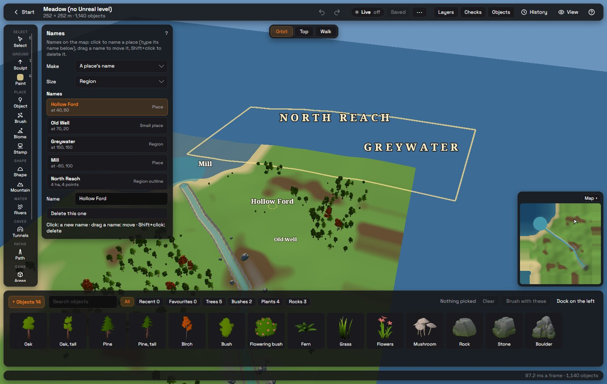

# Names and regions

**Names** on the rail (in Game) puts names on the map: a town, a bay, a peak, a whole land. They show over the 3D view
in a map's lettering, light with a dark edge so they read on any ground, and are kept in the map's names file
(`names.json`).



## Names on places

Pick a **Size**, then click on the map: a new name stands there and is picked. Type its name in the **Name** box (the
typing is one step in History). Drag a name to move it; `Shift`+click it to delete it, or pick it in the list and
**Delete this one**.

| Size | Shown | For |
|---|---|---|
| Region | from anywhere, in big spaced capitals | a land, a sea, a kingdom |
| Place | from 2.5 km or nearer | a town, a bay, a peak, a lake |
| Small place | from 400 m or nearer | a farm, a well, a camp, a shrine |

Where names would cover each other, the bigger and then the nearer one is shown and the other left out until there is
room. Names fade in as you come close enough.

## Regions

Set **Make** to **A region**, then click round the area on the ground; `Enter` (or a click on the first point) closes
it, `Backspace` takes the last point off and `Esc` clears it. The region is named "Region 1" and picked: type its name.
Its name stands over its middle at the region size, and its outline is drawn on the ground. `Shift`+click inside a
region deletes it (the innermost, where regions lie inside each other).

**Names and regions** in the [View panel](editor-basics.md#view-panel) hides them all.

## The names file

```json
{
  "names": [ { "text": "Hollow Ford", "x": 40, "z": 60, "size": "place" } ],
  "regions": [ { "name": "North Reach", "color": [0.95, 0.85, 0.55], "points": [[-100, 120], [200, 120], [220, 260]] } ]
}
```

Places are world metres (x east, z north), as everywhere in the editor; in Unreal that is X = x × 100 and Y = −z × 100
centimetres. A game can read the file to say "You enter North Reach" (the smallest region a point lies in) or to label
its own world map. [Live](unreal.md#live) sends them to the open Unreal level as tagged actors and splines.

Claude places names and regions with `map_name` and `map_region` and lists them in `map_catalog`.
