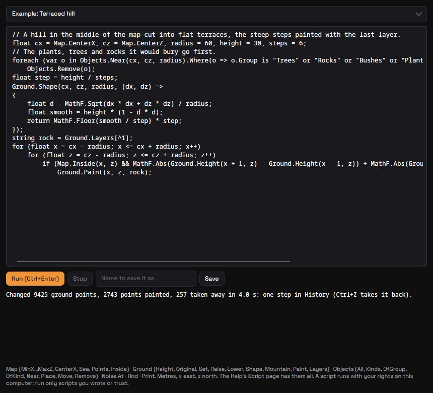

# Script

**⋯ → Script…** runs a few lines of C# on the open map: shape the ground by a rule, paint by height and slope,
scatter objects where the ground is gentle, turn and size every tree. What the script changes goes into the map as one
step in History.

You need nothing installed: the editor compiles the script itself. If you have never written C#, start from an
[example](#the-examples) and change its numbers.

## Use it

1. Open a map, then **⋯ → Script…**.
2. Pick an example or a saved script in the list, or write your own in the code box.
3. Press **Run (Ctrl+Enter)**. The output shows "Compiling…", "Running…", then what the script printed and what it
   changed, or what went wrong.
4. Look at the result. `Ctrl+Z` takes the whole run back in one step. Change the numbers and run again until you like
   it.

Nothing changes while the script runs: when it has finished, everything it changed goes into the map at once. If it has
mistakes, fails, is stopped or runs for 5 minutes, nothing changes. If you change the map while it runs, its changes
are dropped too: run it again.

| Setting | What it does |
|---|---|
| **List** | The examples ("Example: …"), then your saved scripts, newest first. Picking one **replaces** the code: save yours first. |
| **Code box** | The script. `Tab` indents; `Ctrl+Enter` runs it. |
| **Run** | Compiles and runs the script on the open map. Its changes are one step in History, named "Script: " and the list entry's name. |
| **Stop** | Stops a running script, whatever it is doing: nothing it did is kept. |
| Name box, **Save** | Saves the code under the name typed. A script saved under that name already is replaced only when it is the one chosen in the list. |
| **Output** | What the script printed (`Print`), then what it changed, or its mistakes or error with their line. |

Saved scripts are `<name>.csx` files in the `scripts` folder of the editor's data folder (`~/.local/share/Groundwork/scripts`
on Linux). Edit them in any text editor, or share them.

## A script is a program

A script runs with your rights on this computer, like any program you start. It runs in a process of its own, so that
**Stop** can always end it and its memory is capped (4 GB), but that process is not a sandbox: a script can read and
write your files. Run only scripts you wrote or trust.

## The examples

| Example | What it does |
|---|---|
| **Mound in the middle** | Raises a mound 10 m high in the middle of the map and prints where its top is. |
| **Terraced hill** | A hill 30 m high cut into six flat terraces; the trees, rocks and plants it would bury are taken away first, and the steep steps are painted with the map's last layer. |
| **Mountain range across the map** | Four Lone peak mountains in a line from the south-west to the north-east, the same each run. |
| **Canyon with a river** | A winding canyon 18 m wide from west to east, dug 3 m below the sea so water fills it. |
| **Scatter on gentle slopes** | The catalog's first kind in clumps where the ground is gentle and above the sea. |
| **Paint by height and slope** | The first layer everywhere, the second near the sea, the last on steep ground. |
| **Turn and size the trees** | Every tree turned its own way and sized between 0.8 and 1.3. |

## API reference

Everything is in metres on the map: `x` east, `z` north (the 3D view's; Unreal's Y is `-z`), heights above the map's
zero. A script is C# statements; `System`, `System.Linq` and `System.Collections.Generic` are there already.

| Call | What it does |
|---|---|
| `Map.MinX`, `MinZ`, `MaxX`, `MaxZ`, `CenterX`, `CenterZ` | The map's corners and middle. |
| `Map.Sea`, `Map.Name` | Its sea level and name. |
| `Map.Points(step = 1)` | Every ground point, as `(x, z)`, every `step` metres. |
| `Map.Inside(x, z)` | Whether a point is on the map. |
| `Ground.Height(x, z)` | The height now, with the script's changes so far. |
| `Ground.Original(x, z)` | The height of the map's heightmap, before any edit. |
| `Ground.Set(x, z, h)`, `Raise(x, z, m)`, `Lower(x, z, m)` | Changes the point's height. Points off the map are left alone. |
| `Ground.Shape(x, z, radius, (dx, dz) => metres)` | Adds what the function returns to every point within `radius` of `(x, z)`. |
| `Ground.Mountain(x, z, preset, height, radius, rough, turn, seed)` | A mountain of the [Mountain tool](shapes.md#mountain): `"Lone peak"`, `"Ridge"`, `"Mountain range"`, `"Mesa"`, `"Volcano"` or `"Rolling hills"`. A value left at 0 is picked from the seed. |
| `Ground.Layers` | The map's ground layers' names. |
| `Ground.Paint(x, z, layer, strength = 1)` | Paints a layer at the point. |
| `Objects.All` | Every object, as it was when the script started: `Id`, `Kind`, `X`, `Y`, `Z`, `Group`, `Yaw`, `Pitch`, `Roll`, `Scale`. |
| `Objects.Kinds` | The kinds a script can place: the catalog's models. |
| `Objects.OfGroup(group)`, `OfKind(kind)`, `Near(x, z, radius)` | Some of them. Groups: Trees, Rocks, Bushes, Plants, Props, Buildings, Markers, Other. |
| `Objects.Place(kind, x, z, yaw, scale, y, pitch, roll)` | A new object of a kind (its model or label). Without `y`, it stands on the ground as the script leaves it. |
| `Objects.Move(o, x, z, y, yaw, pitch, roll, scale)` | Moves, turns or sizes an object; what is left out stays. It keeps its data. |
| `Objects.Remove(o)` | Takes an object away. |
| `Noise.At(x, z, scale = 32, seed = 0)` | Smooth natural noise, about -1 to 1, its bumps `scale` metres across. |
| `Rnd.Seed = n`, `Rnd.Next()`, `Range(min, max)`, `Int(min, max)`, `Chance(p)`, `Pick(a, b, …)` | Random numbers; a seed gives the same ones each run. |
| `Print(x)` | A line in the output (2000 at most). |

A kind that is not in the catalog, a place off the map or a value that is not a number stops the script with an error
naming its line.

## Related

- [Ground graph](graph.md): ground from nodes, without code
- [Shapes and mountains](shapes.md)
